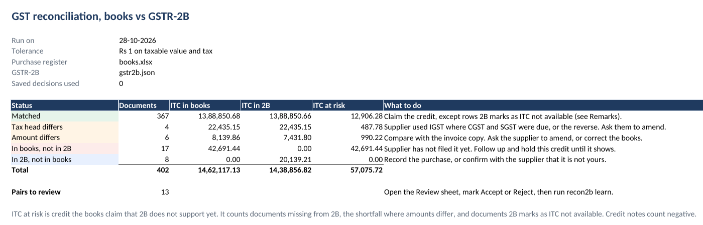
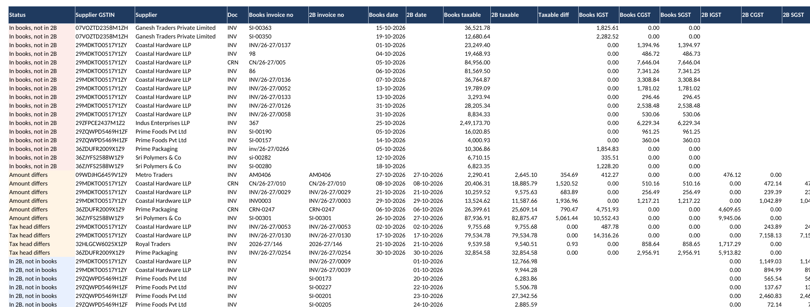
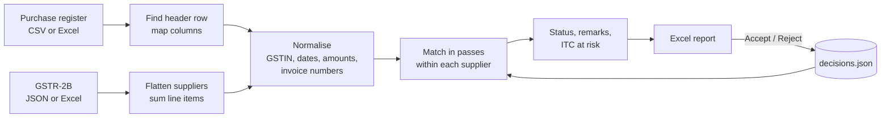

# recon2b

Match a business's purchase register against its GSTR-2B and find out which invoices are fine, which are off, and how much input tax credit is at risk.

Every month, someone at a CA firm exports the books from Tally, downloads GSTR-2B from the GST portal and matches thousands of rows by hand in Excel. Invoice numbers are typed differently on each side, dates drift, and amounts differ by a rupee of rounding. It takes days, and mistakes cost real money. recon2b does it in seconds and explains every difference.



## What it does

- Reads the purchase register as CSV or Excel, finding the header row and the columns on its own (Tally, Zoho, Busy or a hand-made sheet)
- Reads GSTR-2B as the portal's JSON or Excel download, several months at once
- Matches documents in passes, from certain to uncertain, and records which pass made each pair
- Understands that `INV/24-25/0012`, `inv-12`, `INV0012` and `12` can be the same invoice
- Sorts every document into matched, amount differs, tax head differs, missing in 2B or missing in books, with the reason in plain words
- Works out the ITC at risk per document and per supplier, so you know who to call first
- Flags GSTINs in the books that never appear in 2B and suggests the one you probably meant
- Writes an Excel report with Indian digit grouping, ready to hand to a client
- Remembers the accountant's decisions, so next month's run does not ask the same question twice

## Quickstart

```bash
git clone https://github.com/vinayakkothari/recon2b && cd recon2b
pip install -e ".[web]"

recon2b run --books data/sample/books.xlsx --gstr2b data/sample/gstr2b.json --out report.xlsx
```

```
status               documents       ITC at risk
MATCHED                    367         12,906.28
TAX_HEAD_MISMATCH            4            487.78
AMOUNT_MISMATCH              6            990.22
MISSING_IN_2B               17         42,691.44
MISSING_IN_BOOKS             8              0.00
total                      402         57,075.72

13 pairs need a look in the Review sheet.
```

Prefer a browser? `recon2b serve` starts an upload page at http://127.0.0.1:8000, or run it in Docker with `docker build -t recon2b . && docker run -p 8000:8000 recon2b`. Files are processed for that request and deleted straight after.

The sample data is synthetic. Real client files never go in this repo.

## The report

| Sheet | What's in it |
| --- | --- |
| Summary | Documents and ITC per status, what to do about each, and the total at risk |
| Reconciliation | Every document, books and 2B side by side, problems first |
| Review | Pairs the tool was not sure about, with an Accept or Reject dropdown |
| Suppliers | Totals per supplier, sorted by ITC at risk, for follow-up calls |
| GSTIN issues | GSTINs in the books that 2B has never heard of, with a suggestion |



## How it works



### Invoice numbers

Each invoice number gets three keys.

| Key | Rule | `INV/24-25/0012` becomes |
| --- | --- | --- |
| exact | uppercase, trimmed | `INV/24-25/0012` |
| normalised | financial year removed, separators removed, leading zeros dropped | `INV12` |
| number | the last run of digits | `12` |

A financial year is only removed when the two numbers are consecutive, so `12-40` stays an invoice number. Years glued into the number with no separator (`INV26270535`) are removed only for the years the invoice dates actually cover, because `2627` could just as well be a serial number.

### Matching passes

| Pass | Pairs on | Confidence |
| --- | --- | --- |
| manual | a pair the accountant accepted before | 1.00 |
| exact | invoice number as typed, amounts agree | 1.00 |
| normalised | normalised number, amounts agree | 0.95 |
| number | last number, amounts agree, dates within 7 days | 0.90 |
| fuzzy | similar number (rapidfuzz ratio of 85 or more), amounts agree | 0.60 to 0.90 |
| amount_date | the only document with that amount within 5 days | 0.60 |
| exact_amount_off | invoice number as typed, amounts differ | 0.90 |
| normalised_amount_off | normalised number, amounts differ | 0.85 |
| number_amount_off | last number, amounts differ, dates within 7 days | 0.70 |

Each pass only sees what earlier passes left. Pairs below 0.80 go to the Review sheet.

Inside a pass, a document can have several candidates. A pair is kept only when each side is the other's cheapest candidate (amount gap plus date gap), those are assigned, and the rest go round again. That gives a stable one-to-one answer without an expensive global assignment.

## Accuracy and speed

Measured on synthetic data with known right answers, on a 2-core cloud VM. The generator copies the mess seen in practice: about 40% of book entries type the invoice number differently, 8% have the date a few days off, 10% have rounding differences, 2% have wrong amounts, 1% use the wrong tax head, 4% are missing from 2B, 3% are missing from the books, and a few duplicates and GSTIN typos are thrown in.

| Documents | Match time | Precision | Recall | Peak memory |
| --- | --- | --- | --- | --- |
| 10,000 | 0.18 s | 100.00% | 99.91% | 166 MB |
| 100,000 | 1.55 s | 99.99% | 99.84% | 415 MB |
| 1,000,000 | 21.2 s | 99.98% | 99.18% | 2.1 GB |

Precision is how many pairs were right. Recall is how many of the documents that exist on both sides got paired. Full numbers, including time per pass, are in [bench/RESULTS.md](bench/RESULTS.md). Reproduce them with `python bench/benchmark.py`.

At 1 million documents one synthetic supplier has 116,000 invoices in a single month. That is where recall drops. With that many invoices, the same amount within a few days stops being unusual, so the amount-only pass refuses to guess and leaves those for review. I'd rather miss a pair than make a wrong one, because a wrong pair hides a real problem.

Note that the 1 million row report goes to `.parquet` or `.csv`. Excel tops out around a million rows per sheet and xlsx writing becomes the slowest step well before that.

## Design decisions

- **Group by GSTIN before anything else.** Comparing every invoice with every other is quadratic and dies fast. Matching only inside a supplier keeps the work close to linear. The cost is that a GSTIN typo in the books hides every invoice from that supplier, which is why the GSTIN issues sheet exists.
- **Check amounts before trusting a number.** When a typo turns 304 into 340 and 340 also exists, pairing on the number first locks in two wrong pairs. So passes that insist on matching amounts run first, and same-number pairs with different amounts are made only afterwards.
- **Polars instead of pandas.** Every rule is a vectorised expression, so a million rows normalise in a few seconds without a Python loop per row. The cost is a less familiar API.
- **Mutual best instead of optimal assignment.** The Hungarian algorithm would be exact but is cubic. Mutual best in rounds is near-linear and almost always gives the same answer on this kind of data.
- **Decisions keyed on normalised numbers.** An Accept made in October still applies when the same documents show up in a revised run. The cost is that two genuinely different documents with the same normalised number from one supplier would share a decision, which is rare.
- **No database for version one.** It is a file-in, file-out tool, which is how accountants work today. The scaling section below covers when that changes.

## Scaling to production

A CA firm with 300 clients reconciling every month is the real target. Here is what changes as the load grows.

1. **Many clients.** Each client and month is an independent job. Put jobs on a queue (SQS or Redis), run stateless workers, and store results and decisions in Postgres keyed by client GSTIN and period. Workers scale on queue depth.
2. **Large clients.** Supplier groups are independent, so a single huge reconciliation can be split by GSTIN hash across workers with no coordination. The fuzzy pass already blocks very large suppliers by amount.
3. **Normalisation cost.** Today the invoice number regexes run on every row. Running them on unique numbers only, and caching the keys per supplier between months, removes most of that time.
4. **Pulling 2B directly.** The GST portal's API access goes through GST Suvidha Providers. Integrating one removes the download step and lets reconciliation run as soon as a supplier files.
5. **Continuous instead of monthly.** With 2B fetched daily, a supplier who has not filed can be chased before the return is due, not after.

## Using your own files

The books need at least a supplier GSTIN, an invoice number and a taxable value. Dates, tax heads, document type and supplier name are picked up when present. If your export uses unusual headers, point at them with a column map.

```bash
recon2b run -b purchases.xlsx -g 2b_oct.json -g 2b_nov.json --column-map examples/column_map.json
```

Document type means the supplier's document. A purchase return the supplier issued a credit note for is `Credit Note`, even if Tally records it as a debit note voucher on your side.

Useful flags: `--tolerance 1` (rupees), `--date-window 7` (days), `--fuzzy 85`, `--sheet "Purchase Register"`, `--decisions decisions.json`.

### The review loop

1. `recon2b run ... --decisions decisions.json --out report.xlsx`
2. Open the Review sheet, choose Accept or Reject for the pairs you checked
3. `recon2b learn report.xlsx --decisions decisions.json`
4. Next month's run applies those answers before any automatic matching

To pair two documents by hand, use `recon2b pair --gstin ... --books-inv ... --gstr2b-inv ...`.

## Development

```bash
pip install -e ".[dev]"
pytest              # about 50 tests, a few seconds
ruff check . && ruff format --check .
recon2b synth --invoices 50000 --out-dir data/big && recon2b eval data/big
```

```
src/recon2b/
  loaders/      CSV and Excel header detection, GSTR-2B JSON and Excel
  normalise.py  invoice number keys, GSTIN checksum, dates, amounts
  matcher.py    the passes, mutual best assignment, status and ITC at risk
  report.py     the Excel workbook
  decisions.py  Accept and Reject memory
  synth.py      synthetic data with hidden right answers, and the evaluator
  cli.py, web.py, pipeline.py
```

## Limitations

- Tested on synthetic data and on files built to copy the portal's layout. Real exports have quirks that only real files reveal, and issues with anonymised examples are very welcome.
- Import of goods (IMPG), ISD credit and amendments that change the GSTIN are not matched yet.
- This is a tool to speed up the work, not tax advice. A person still decides what credit to claim.

## License

MIT
